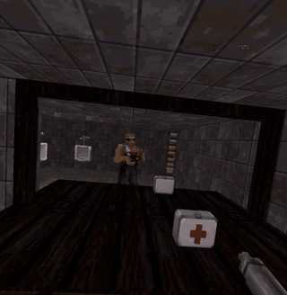
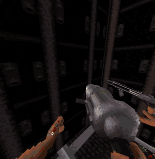

  
  

<h1 align="center">EDuke VR</h1>

Duke Nukem 3D in VR, built on [EDuke32](https://www.eduke32.com/). Play the whole game in a VR
headset or on a normal screen, alone or with friends in co-op and DukeMatch. VR and non-VR players
can play together.

You need your own copy of Duke Nukem 3D (for example the 20th Anniversary World Tour on Steam). No
game data is included.

**[Download the latest release](../../releases)**

## Features

- Hold and aim weapons with your hands, aim with both hands, throw pipebombs and kick with the
  mighty foot.
- A full Duke body that you and other players can see.
- Co-op and DukeMatch with voice chat.
- 3D models for Duke, his hands and weapons, including Voxel Duke if you have that mod.
- Snap or smooth turning and room-scale movement.

## How to play

1. Download the release for your system (Windows, Linux, or Linux ARM such as the Steam Frame) and
   unpack it.
2. Put `DUKE3D.GRP` in `data/grp/`, or let the game find your installed copy.
3. Start your VR runtime (SteamVR, Meta, Monado, WiVRn...) and run `play.bat vr` on Windows or
   `./play.sh vr` on Linux. Use `desktop` instead of `vr` to play without a headset.

To join a server, run `join.bat HOST` or `./join.sh HOST`. To update, run `./update.sh`, or on
Windows right-click `update.ps1` > **Run with PowerShell**. Your settings, saves and model sets are
kept.

VR options are under **Options > VR Setup**. Controls, multiplayer, model sets and everything else
are in [docs/vr/PLAYING.md](docs/vr/PLAYING.md).

### Do other players need it?

Yes. Everyone in a multiplayer game, including the server, needs the same version of EDuke VR.
Friends without a headset can play in desktop mode.

## Building from source

See [docs/BUILDING.md](docs/BUILDING.md).

## License

EDuke VR is a modified version of EDuke32 and uses the same licenses: the
[GNU GPL v2](package/common/gpl-2.0.txt), and Ken Silverman's
[BUILD engine license](package/common/buildlic.txt) for `source/build`, which allows non-commercial
use only, so EDuke VR may not be sold. Bundled libraries keep their own licenses, listed in each
release's `licenses/THIRD-PARTY.txt`.

Duke Nukem 3D is a trademark of Gearbox Software. This is a community project, not affiliated with
Gearbox, 3D Realms or Voidpoint.

## Credits

EDuke32 by Richard "TerminX" Gobeille, Evan "Hendricks266" Ramos and the Voidpoint team. The Build
engine by Ken Silverman. Duke Nukem 3D by 3D Realms. JFDuke3D by Jonathon Fowler.
